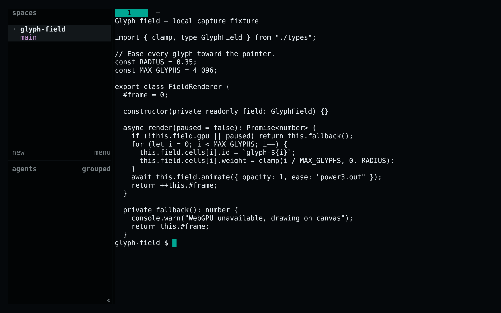
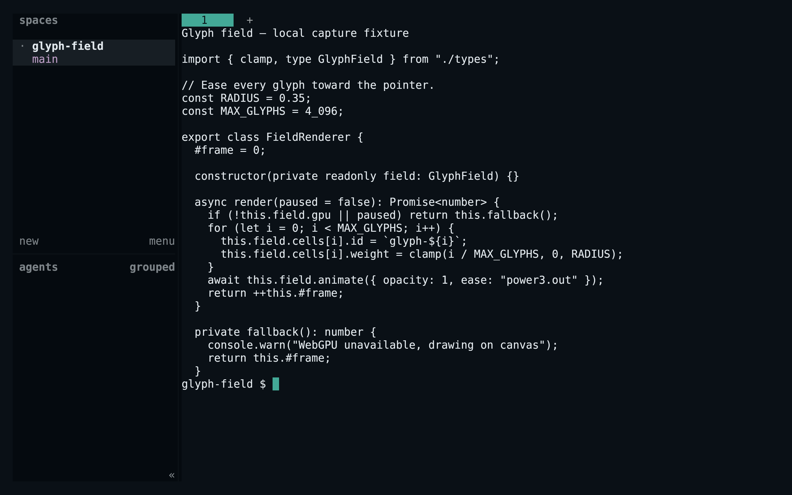
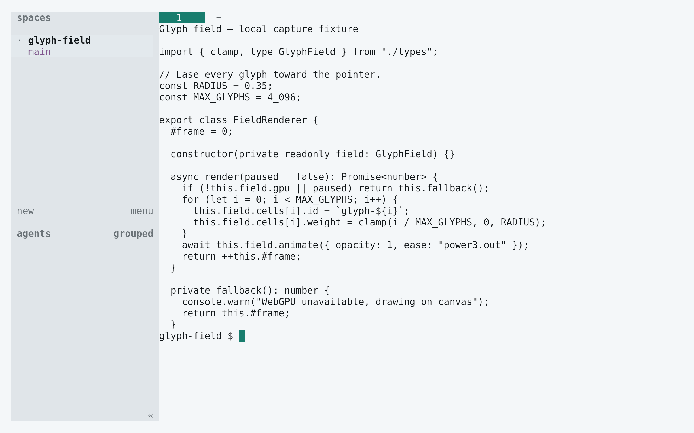
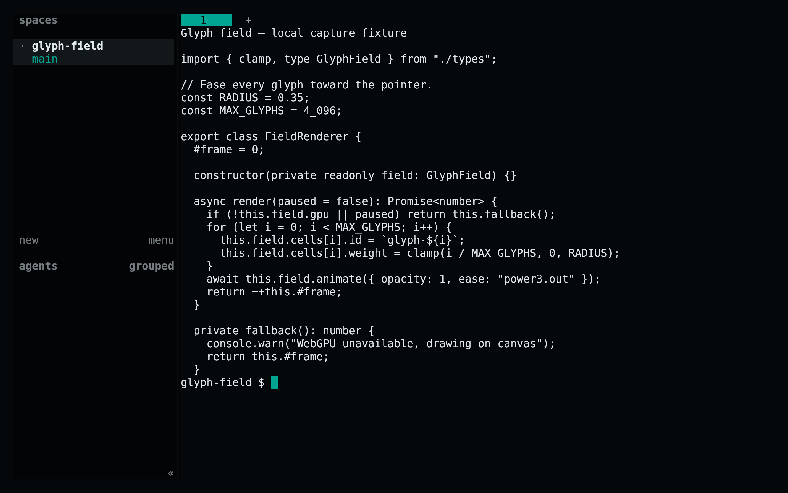

<!-- living-code-readme:1 -->
# 🐑 Living Code for Herdr

**Calm slate. Living color.** Living Code for Herdr: complete native theme overrides for the sidebar, panels, selections, status indicators and workspace chrome.

[Installation](#installation) · [Flavors](#flavors) · [Configuration](#configuration) · [All ports](https://github.com/living-code-theme)

## Previews

<table data-lc-flavors>
<tr>
<td width="50%" valign="top">
<strong>Night</strong><br><sub>Dark · full palette</sub><br><br>
<a href="images/night.png"></a>
</td>
<td width="50%" valign="top">
<strong>Frost</strong><br><sub>Dark · softer chroma</sub><br><br>
<a href="images/frost.png"></a>
</td>
</tr>
<tr>
<td width="50%" valign="top">
<strong>Paper</strong><br><sub>Light · near-white slate</sub><br><br>
<a href="images/paper.png"></a>
</td>
<td width="50%" valign="top">
<strong>Signal</strong><br><sub>Dark · teal accent</sub><br><br>
<a href="images/signal.png"></a>
</td>
</tr>
</table>

Select any preview to view the image at full size.

## Installation

```sh
flavor=night # night, frost, paper, or signal
theme_dir="$(dirname "${HERDR_CONFIG_PATH:-${XDG_CONFIG_HOME:-$HOME/.config}/herdr/config.toml}")/themes"
curl -fsSL --create-dirs -o "$theme_dir/living-code-$flavor.toml" "https://raw.githubusercontent.com/living-code-theme/herdr/main/themes/living-code-$flavor.toml"
```

Herdr currently has no standalone theme-file import. Merge `[theme]` and `[theme.custom]` from the downloaded fragment into your active `config.toml` (normally `~/.config/herdr/config.toml`, or `HERDR_CONFIG_PATH`). Replace existing theme tables rather than appending duplicates. **Do not replace your whole config**: keep workspaces, keybindings and integrations. Then reload:

```sh
herdr server reload-config
```

## Flavors

Expand a flavor for its full-size preview and activation instructions.

<details data-lc-flavor="night">
<summary><strong>Night</strong> · Dark · full palette</summary>

<p><a href="images/night.png"></a></p>

Merge `[theme]` and `[theme.custom]` from the downloaded `living-code-night.toml` into the active config, then run `herdr server reload-config`.

</details>

<details data-lc-flavor="frost">
<summary><strong>Frost</strong> · Dark · softer chroma</summary>

<p><a href="images/frost.png"></a></p>

Merge `[theme]` and `[theme.custom]` from the downloaded `living-code-frost.toml` into the active config, then run `herdr server reload-config`.

</details>

<details data-lc-flavor="paper">
<summary><strong>Paper</strong> · Light · near-white slate</summary>

<p><a href="images/paper.png"></a></p>

Merge `[theme]` and `[theme.custom]` from the downloaded `living-code-paper.toml` into the active config, then run `herdr server reload-config`.

</details>

<details data-lc-flavor="signal">
<summary><strong>Signal</strong> · Dark · teal accent</summary>

<p><a href="images/signal.png"></a></p>

Merge `[theme]` and `[theme.custom]` from the downloaded `living-code-signal.toml` into the active config, then run `herdr server reload-config`.

</details>

## Configuration

Every documented custom token is supplied. `auto_switch = false` makes the chosen flavor deterministic; Paper uses a light built-in fallback, all other flavors use a dark fallback. For appearance switching, Herdr also accepts `[theme.custom.light]` and `[theme.custom.dark]`; combine the selected light/dark overrides intentionally rather than duplicating `[theme]` tables.

## Compatibility

The custom-token interface is present in Herdr 0.9.3 and is checked against the pinned upstream Rust fields. This themes Herdr’s own UI. Embedded terminal panes inherit the host terminal’s palette and application-specific themes, so install the matching Living Code terminal theme too. No agent sessions or workspaces are created by this port.

Previews are captured programmatically from the actual application in an isolated profile. See [`capture/app.py`](capture/app.py) for the app-owned recipe and [`images/capture.json`](images/capture.json) for runtime, palette and image provenance. No mock interface is drawn.

## Contributing

Found a problem? [Open an issue](https://github.com/living-code-theme/herdr/issues/new/choose) with the app version, the flavor and a screenshot. Want Living Code somewhere else? [Request a port](https://github.com/living-code-theme/core/issues/new?template=port-request.yml).

Pull requests are welcome. Keep this README, `port.json` and `images/` in sync, and use real screenshots of the app, never mockups.

🦎 **One chameleon, many habitats.** Part of [Living Code](https://github.com/living-code-theme).

## License

[MIT](LICENSE) © Elliot Luque
